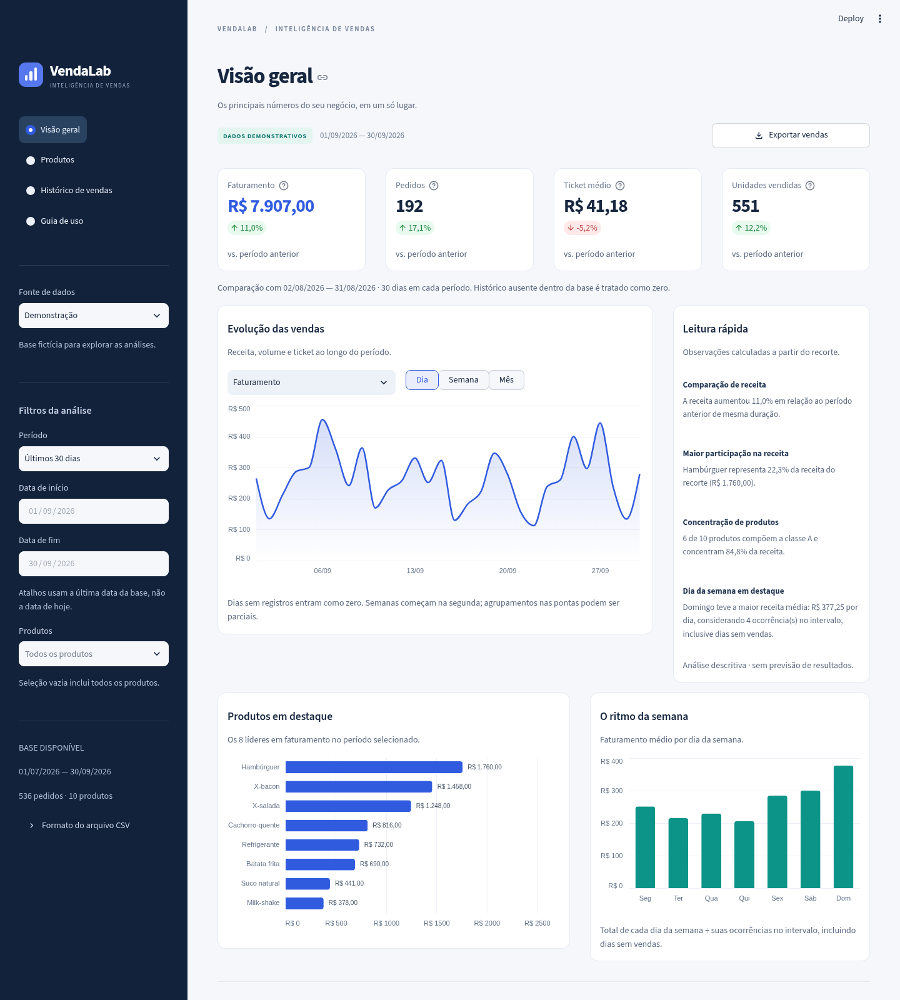

# VendaLab — Análise de vendas

O **VendaLab** é um dashboard em **Streamlit** para explorar vendas de uma lanchonete: acompanhar o faturamento, comparar períodos, entender o desempenho dos produtos e consultar os itens vendidos. O projeto mantém a análise original pelo terminal e amplia o fluxo para trabalhar com arquivos CSV.



## O que o painel oferece

- Indicadores de faturamento, pedidos distintos, ticket médio e unidades vendidas.
- Filtros por período e produtos, aplicados às análises e às exportações.
- Comparação com o período imediatamente anterior, de mesma duração.
- Evolução das vendas por dia, semana ou mês, incluindo datas sem vendas.
- Ranking de produtos, participação no faturamento e classificação ABC.
- Desempenho por dia da semana, considerando todas as ocorrências do dia no período.
- Leituras automáticas dos dados, com fatos sobre receita e concentração das vendas.
- Histórico dos itens vendidos, importação de CSV e exportação dos resultados.

As fontes disponíveis são uma **demonstração fictícia**, os **pedidos originais** de `dados.py` e um **CSV enviado pelo usuário**. Os dados demonstrativos não representam resultados de um negócio real.

## Executar localmente

Requisito: **Python 3.12**. As versões das dependências estão fixadas em `requirements.txt`.

```bash
git clone https://github.com/Mouraaxsv/Analise-de-vendas.git
cd Analise-de-vendas
python3.12 -m venv .venv
source .venv/bin/activate
python -m pip install -r requirements.txt
python -m streamlit run app.py
```

No Windows, substitua a ativação por:

```powershell
.venv\Scripts\Activate.ps1
```

Abra o endereço informado pelo Streamlit no terminal. Para um servidor sem interface gráfica, utilize:

```bash
python -m streamlit run app.py --server.headless=true
```

No ambiente na nuvem já preparado, o checkout está em `/workspace/Analise-de-vendas` e o Python com as dependências está em `/workspace/.venvs/analise-de-vendas/bin/python`.

## Usar o painel

1. Escolha a fonte de dados na barra lateral. Comece pela demonstração para explorar um histórico de julho a setembro de 2026, ou selecione os pedidos originais para reproduzir o exemplo inicial.
2. Para analisar suas vendas, escolha a importação de CSV e envie um arquivo no [formato documentado](docs/DADOS.md). O painel disponibiliza um modelo para download.
3. Ajuste o período e os produtos. O padrão é **Últimos 30 dias**, contados a partir da última data da base e limitados ao início do histórico disponível. Há também **Últimos 7 dias**, **Todo o período** e **Personalizado**; neste último, as datas ficam editáveis. As duas datas do intervalo são incluídas.
4. Navegue pelas seções na barra lateral. Compare os indicadores com o período anterior e use os gráficos para examinar a distribuição das vendas.
5. Use **Exportar vendas** para baixar o recorte dos filtros globais, **Exportar análise de produtos** para baixar o ranking ou **Baixar tabela exibida** para exportar os resultados da busca no histórico.

| Seção | O que analisar |
| --- | --- |
| Visão geral | Indicadores, evolução diária/semanal/mensal, leituras automáticas, oito produtos líderes e receita média por dia da semana |
| Produtos | Curva ABC, composição da receita e tabela completa do desempenho por produto |
| Histórico de vendas | Itens vendidos, busca por produto ou identificador de pedido e download da tabela exibida |
| Guia de uso | Orientações dentro do painel, modelo CSV, interpretação dos indicadores e limites da análise |

No histórico, a busca é literal e não diferencia maiúsculas de minúsculas. Ela afeta apenas a tabela e **Baixar tabela exibida**, sem alterar os indicadores ou **Exportar vendas**. Os filtros globais continuam valendo antes da busca.

O filtro de produtos seleciona **itens** dos pedidos. Um pedido com dois produtos será contado uma única vez se ao menos um de seus itens estiver no filtro; o faturamento e o ticket considerarão apenas os itens selecionados. Consulte a [metodologia](docs/METODOLOGIA.md) antes de comparar recortes diferentes.

### Continuar usando o terminal

```bash
python main.py
```

O fluxo original usa os dois pedidos de `dados.py`, com faturamento de **R$ 94,00**, **2 pedidos** e **7 unidades**. O filtro original de 24/09/2026 retorna **1 pedido** e **R$ 64,00**.

## Verificar o projeto

Com o ambiente virtual ativo, execute:

```bash
python -m pip check
python -m unittest discover -s tests -v
```

Os testes cobrem os cálculos analíticos, a leitura e validação de CSV e o comportamento do painel por meio do `AppTest` do Streamlit. Não é necessário instalar um servidor de banco de dados ou fornecer credenciais para o fluxo padrão.

## Organização

```text
Analise-de-vendas/
├── app.py                 # Interface e filtros do dashboard Streamlit
├── metricas.py            # Indicadores, séries, rankings e comparações
├── fontes.py              # Dados demonstrativos, importação e exportação
├── visualizacoes.py       # Gráficos interativos com Altair
├── dados.py               # Pedidos de exemplo do projeto original
├── analises.py            # Funções de análise do fluxo original
├── main.py                # Relatório original pelo terminal
├── requirements.txt       # Dependências com versões fixadas
├── .streamlit/config.toml # Tema, modo headless e limite de upload
├── tests/                 # Testes automatizados
└── docs/
    ├── DADOS.md            # Contrato e exemplos dos arquivos CSV
    └── METODOLOGIA.md      # Fórmulas e interpretação dos indicadores
```

## Publicar com Streamlit

Uma opção é usar o **Streamlit Community Cloud**. Depois de salvar o projeto no GitHub, crie uma aplicação no serviço, selecione este repositório e o branch desejado, informe `app.py` como arquivo de entrada e configure Python 3.12. As dependências são obtidas de `requirements.txt`. Estas são orientações de publicação; o repositório não pressupõe uma aplicação já publicada.

## Limites e interpretação

- A aplicação não possui cadastro de usuários, controle de acesso, banco de dados ou gravação permanente dos arquivos enviados. A importação é processada em memória durante a sessão; mantenha o CSV original e baixe os resultados que quiser guardar.
- O limite de importação é de **10 MiB (10.485.760 bytes) e 100 mil linhas de itens**. Arquivos inválidos são rejeitados com uma mensagem de validação; o painel não elimina silenciosamente linhas com problemas.
- Cada análise admite uma diferença de até **1.095 dias entre início e fim**. Se a base cobrir um histórico maior, use **Personalizado** para escolher um recorte; o arquivo permanece carregado.
- O faturamento corresponde a quantidade × preço unitário. Não existem dados de custos, impostos, descontos, devoluções ou margem; os indicadores **não medem lucro**.
- Ausência de vendas no arquivo não permite distinguir um dia sem pedidos de um dia em que o estabelecimento estava fechado. A média por dia da semana utiliza o calendário do período selecionado.
- Comparações e leituras automáticas descrevem o arquivo disponível. Elas não demonstram causas, não preveem vendas futuras e dependem da completude da base importada.

Documentação detalhada: [formato dos dados](docs/DADOS.md) · [metodologia dos cálculos](docs/METODOLOGIA.md).
